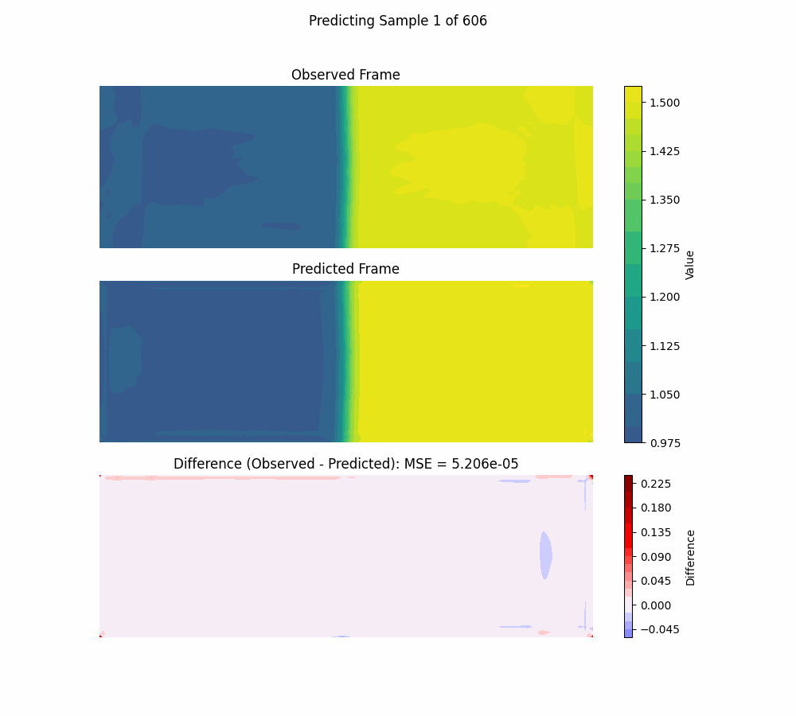
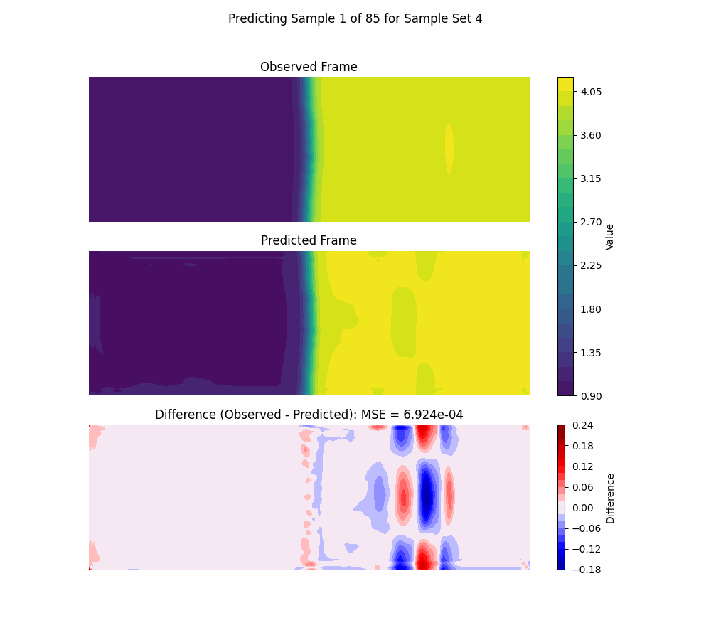

# Deep Learning 2D LSTM CNN

This tutorial will use Deep Learning to train a 2D LSTM CNN model on Pyranda 2D Simulation data. This tutorial expands on the Pyranda Rayleigh Taylor tutorial workflow and modifies it to use deep learning.

## Overview

[Pyranda](https://github.com/LLNL/pyranda) is an mpi parallel high order finite difference solver for arbitrary hyperbolic PDE systems. We will use Pyranda to run an ensemble of Rayleigh-Taylor simulations with different parameters and save their 2D time history data as numpy files. We will then use that data to train a 2D LSTM CNN model using [Tensorflow](https://www.tensorflow.org/) which is a Machine Learning library developed by Google. [Keras](https://keras.io/) is an API for Tensorflow that allows users to easily and more intuitively work with Tensorflow. We will use [Maestro](https://maestrowf.readthedocs.io/en/latest/) to orchestrate this workflow.

## Visualization Deep Learning 2D LSTM CNN Python Script

This python script allows the user to train a deep learning model and visualize its predictions. The python script can be updated as needed to modify the deep learning model and post-process the prediction results. The python script has more details on what training a deep learning model entails.

Below is the 2D LSTM CNN deep learning model and its predictions which showcases its logic. This is where fine tuning the model becomes an "art" since adjusting these values could give a completely different prediction. What works for this set of data might not work for another. Note that due to the randomness of the data split, the predictions below will not be the same each time.

First we check if we have GPUs with `tf.config.list_physical_devices('GPU')`. If we have GPUs we use `strategy = tf.distribute.MirroredStrategy()` else we use `strategy = tf.distribute.get_strategy()`. This if-else statement allows the parallel context manager `strategy = tf.distribute.get_strategy()` to work even if we just run the script on a single cpu.

```
import tensorflow as tf

# See if we have GPUs
gpus = tf.config.list_physical_devices('GPU')

if gpus:
    # Use all GPUs
    print("########## GPUs detected. Using MirroredStrategy. ##########")
    print(gpus)
    strategy = tf.distribute.MirroredStrategy()
else:
    # Use CPU
    print("########## No GPUs detected. Using CPU only. ##########")
    tf.config.set_visible_devices([], 'GPU')
    strategy = tf.distribute.get_strategy()  # Default strategy for single device

with strategy.scope():
    model = tf.keras.Sequential([

        # LSTM over time, with conv over space
        tf.keras.layers.ConvLSTM2D(
            filters=64,
            kernel_size=3,
            padding='same',
            return_sequences=False, # only next 2d grid
            activation='relu',
            input_shape=(window, 64, 256, 1)
        ),

        # Small conv head to map hidden state to next grid
        tf.keras.layers.Conv2D(
            filters=32, # how many feature maps
            kernel_size=3,
            padding='same',
            activation='relu'
        ),

        # Final conv layer to get final 2D Matrix prediction
        tf.keras.layers.Conv2D(
            filters=1, # reduce feature maps from previous layer to 1 to get final image
            kernel_size=3,
            padding='same',
            activation='linear' # final layer is linear since values can be negative
        )
    ])

    # Compile the model
    model.compile(optimizer='adam', loss='mse', metrics=['mae'])
```

### Deep Learning 2D LSTM CNN Single Prediction

This simple model with lower number of epochs is great at predicting one frame at a time. Matches pretty well!



### Deep Learning 2D LSTM CNN Evolving Prediction

However, if we pass in the prediction to predict the next one and so on, this simple model with lower number of epochs doesn't do so great. This model might need to be more complex, more epochs, and/or more train data.



## How to run

1. Run `sh setup.sh` in the top directory to create the `weave_demos_venv` virtual environment with all necessary dependencies and install the jupyter kernel but do not activate it.

2. Change directory `cd` back into this tutorial's directory and run `sh pyranda_setup.sh` to create a virtual environment with Pyranda since it requires older versions of Python packages that are incompatible with the `weave_demos_venv` virtual environment. Do not activate this environment as it will only be used to run the Pyranda simulations in the Maestro spec.

3. Activate the `weave_demos_venv` with `source ../../weave_demos_venv/bin/activate` to enter the virtual environment (you can `deactivate` when you've finished the demo to exit it).

4. Run `maestro run rayleigh_taylor_deep_learning.yaml -y` to run the Pyranda simulations, train the deep learning 2D LSTM CNN model, and perform inference.

## Content overview

### Starting files:

- `rayleigh_taylor_deep_learning.yaml`: A Maestro spec to run the Pyranda simulations, train the deep learning 2D LSTM CNN model, and perform inference.
- `rayleigh_taylor.py`: A Python script to run the Pyranda simulations and save their data as numpy files.
- `deep_learning.py`: A Python script to rain the deep learning 2D LSTM CNN model and perform inference.

### Files created by the demo:

- `predict_*.png`: Predictions of the deep learning 2D LSTM CNN model.
- `0_prediction_sequence.gif`: GIF of the observed simulation, predicted simulation, and difference of the simulations.
- `mses.png`: MSEs of all the predictions.
- `my_model.keras`: Tensorflow Keras 2D LSTM CNN model.